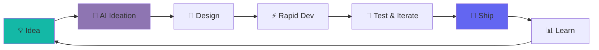

<div align="center">

<!-- Animated Header -->


<br/>


<h1>
  
</h1>

<p align="center">
  <em>🎯 Crafting digital experiences for the focused mind.</em>
</p>

<p align="center">
  <a href="https://pixl.life">
    
  </a>
  <a href="mailto:contact@pixl.life">
    
  </a>
  
</p>

<br/>

<!-- Dynamic Stats -->


</div>

<br/>

---

<div align="center">

## 🌟 About Us

</div>

<table align="center">
<tr>
<td width="50%" valign="top">

### 🎨 **Philosophy**

We're not just another software house. **PixL Studios** is where human creativity meets AI intelligence. We build tools that:

- ✨ **Respect your time** - No bloat, just results
- 🎯 **Enhance focus** - Designed for deep work
- 🤝 **Collaborate intelligently** - Human + AI synergy
- 🚀 **Ship fast** - AI-accelerated development

</td>
<td width="50%" valign="top">

### 🎯 **Vision**

```yaml
mission: "Digital tools for modern minds"
approach: "AI-Native Development"
quality: "Premium experiences"
speed: "Rapid iteration"
values:
  - Focus over distraction
  - Quality over quantity
  - Innovation over convention
```

</td>
</tr>
</table>

<br/>

---

<div align="center">

## 💎 Featured Projects

</div>

<div align="center">

<table>
<tr>
<td align="center" width="100%">

### ⏳ **TimeBoX**


<p align="left">
<br/>
<strong>The ultimate productivity companion for the focused mind.</strong>
<br/><br/>
🎯 <em>Time blocking meets intelligent task management</em><br/>
🧠 <em>AI-powered focus sessions</em><br/>
📊 <em>Beautiful analytics for your workflow</em><br/>
🔒 <em>Privacy-first, locally-powered</em>
</p>

<br/>


</td>
</tr>
</table>

<br/>

<sub>🚀 *Stay tuned for more innovative projects*</sub>

</div>

<br/>

---

<div align="center">

## 🛠️ Technology Stack

</div>

<div align="center">

### **Core Technologies**

<table>
<tr>
<td align="center" width="25%">

<br/><strong>Next.js</strong>
<br/><sub>React Framework</sub>
</td>
<td align="center" width="25%">

<br/><strong>React Native</strong>
<br/><sub>Mobile Apps</sub>
</td>
<td align="center" width="25%">

<br/><strong>Supabase</strong>
<br/><sub>Backend & DB</sub>
</td>
<td align="center" width="25%">

<br/><strong>TypeScript</strong>
<br/><sub>Type Safety</sub>
</td>
</tr>
</table>

<br/>

### **AI-Powered Development** 🤖


<br/><br/>

### **Infrastructure & Tools**


</div>

<br/>

---

<div align="center">

## 🎯 Our Approach

</div>



<br/>

---

<div align="center">

## 📫 Connect With Us

<br/>

<a href="https://pixl.life">
  
</a>
<a href="mailto:contact@pixl.life">
  
</a>

<br/><br/>

<sub>We're always interested in collaborating on exciting projects!</sub>

</div>

<br/>

---

<div align="center">


<br/>

**PixL Studios** • *Est. 2025* • *Made with ❤️ in India*

<br/>

<sub>Building the future, one focused moment at a time.</sub>

</div>
