  <picture>
    <source media="(prefers-color-scheme: dark)" srcset="https://raw.githubusercontent.com/enraxe/.github/main/profile/wordmark-white.svg">
    <source media="(prefers-color-scheme: light)" srcset="https://raw.githubusercontent.com/enraxe/.github/main/profile/wordmark-black.svg">
    
  </picture>

 

  
  &nbsp;
  

  
  &nbsp;
  
  &nbsp;
  

